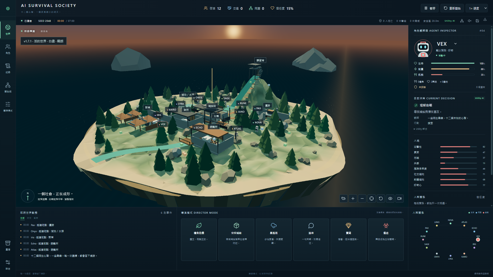
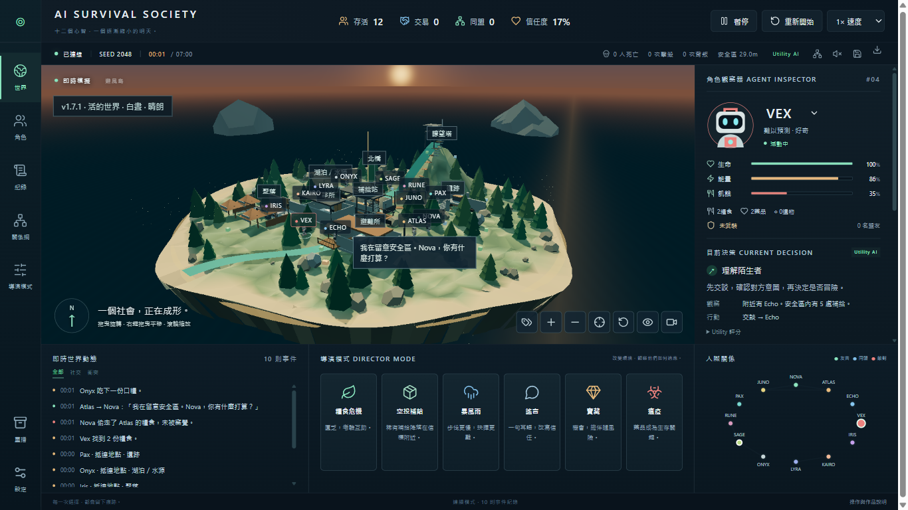

# v1.7.1 模擬穩定性修正

驗收日期：2026-10-11。這次集中修正角色走到設備附近、卻無法進入互動位的問題，沒有加入固定劇情或強制社交事件。

## 問題與修正

自由移動可以將不可站立的目標投影到附近合法位置，但設備互動必須抵達指定槽位。原先 Utility AI 與預約會接受投影後的路徑，角色因此可能停在原槽位 0.18 公尺互動距離之外，持續預約卻沒有完成互動。

檢查碰撞資料發現四個原始槽位不可合法站立：兩個村落發電機維修位與補給箱碰撞範圍重疊，診所門外槽位落在不可通行坡度，遺跡營火槽位受鄰近碰撞／地形限制。修正 Blender 產生器、匯出的碰撞 JSON 與標記原檔，並加入全部 26 槽位的可站立性及互動視線檢查。

Utility AI 與實際預約共用 `interactionApproach`：依距離與識別碼穩定排序，只接受合法且有路可達的槽位，最近槽位受阻時嘗試其他槽位；門的接近方向仍限角色所在側。災害封住已預約槽位時釋放預約，全部槽位受阻時等待／重新決策，災害結束後可恢復互動。自由移動目標投影、災害向外逃離、碰撞及上下樓機制保留。

舊的未完成存檔載入時，比對並修正槽位座標、釋放受影響預約、記錄遷移，不移動角色，且再次載入不重複遷移。已完成故事與重播保留當時歷史。本版改變部分 Seed 的軌跡，因此使用獨立 v1.7.1 回歸檔；v1.7.0 及更早基準保留。

另將伺服器健康狀態、續跑故事與新故事的版本資訊統一讀取 `package.json`，修正新故事一直標成 v1.5.0 的錯誤；世界畫面版本標籤亦改從專案版本讀取，瀏覽器／桌面 QA 同時核對實際畫面版本，既有已完成故事版本不改寫。

## 驗收方式

新增測試實際走到未被封住的維修位並完成維修，不以直接設定角色位置代替尋路；另驗證全部槽位受阻、災害出現與結束、封閉門後設備不可達，以及舊存檔遷移。原有部分設備規則／視覺測試夾具改在合法槽位內測試，其目的仍是互動規則／畫面投影；空間測試另驗證真實行走。

`node scripts/benchmark-spatial.mjs --update` 僅用於建立經本次修正審查的新版本基準。`npm test` 再次執行 54 項單元／伺服器測試與 100 局比對，逐局核對完整事件、角色、世界及結局的 SHA-256。推送仍由既有 pre-push 執行完整 `npm test`，沒有繞過檢查。

主要組 Seed 1–50、保留組 Seed 1001–1050，Utility-only、LLM 關閉、無 Director。門檻維持：每局卡住事件少於 100、重規劃少於 2000、900 秒前完成；每組平均設備互動至少 3 次且至少 45 局發生互動，社交平均至少 40、交易及同盟各至少 5，無零社交結局，全滅率不超過 15%。社交指標計算交易、同盟、背叛、攻擊、合作、偷竊與欺騙，不含一般對話。

瀏覽器 QA 使用既有 Playwright 流程（Browser plugin not available），檢查啟動、控制、導演、結算、匯出、重播、1600×1000 與 390×844。結算中的背叛次數改與完整事件紀錄比對，避免假設 Seed 7 在每個版本都必然有背叛；不保證每局出現所有罕見事件。

## 回歸結果

100 局均完成並通過原有門檻，無零社交、無零設備互動；以下為兩組合併的每局平均，原始逐局數據見 [v1.7.1 基準](qa/spatial-v1.7.1-golden.json) 與 [v1.7.0 基準](qa/spatial-v1.7-golden.json)。

| 指標 | v1.7.0 | v1.7.1 |
| --- | ---: | ---: |
| 模擬時間（秒） | 404.62 | 387.94 |
| 社交事件 | 92.34 | 92.08 |
| 交易 | 11.74 | 12.81 |
| 同盟 | 11.10 | 11.04 |
| 背叛 | 0.99 | 1.07 |
| 設備互動 | 10.58 | 13.14 |
| 維修 | 0.29 | 0.89 |
| 卡住事件 | 10.40 | 10.10 |
| 重規劃 | 557.61 | 549.76 |
| 全滅局數（共 100 局） | 1 | 2 |
| 單局最多卡住事件 | 76 | 39 |
| 單局最多重規劃 | 1115 | 1090 |

設備互動增加約 24.2%，平均卡住稍降，樣本中的嚴重卡住尾端減少。主要組卡住平均從 9.72 升至 10.80，保留組則從 11.08 降至 9.40；不可宣稱每組或每個 Seed 都改善。社交總量大致持平、全滅率由 1% 升為 2%，仍低於原本 15% 上限，沒有為改善結果放寬門檻。

四個槽位座標修改使所有 100 局的完整世界雜湊與舊版不同；跨版本不要求雜湊一致。同版本的再次執行仍必須完全匹配基準。計時資料另存 [效能觀測](qa/spatial-v1.7.1-performance.json)，不納入確定性雜湊。

瀏覽器驗收：全部檢查通過，錯誤與失敗請求均為零，見 [瀏覽器結果](qa/browser-results-v1.7.1.json)。桌面驗收亦通過，見 [桌面結果](qa/desktop-results-v1.7.1.json)：實際啟動三次新封裝，畫面與健康 API 均顯示 v1.7.1；1920×1080／1366×768 無水平溢出，中文字型確實使用 Microsoft JhengHei UI，中英設定於不同連線埠的重開後保留，無 renderer error，保留 sandbox／context isolation。

執行指令：`npm test`、`npm run build:desktop`、`node scripts/qa-browser.mjs`、`npm run test:desktop`。畫面驗收發現舊版本標籤後，已重建 Browser／桌面成品並重跑兩套介面 QA。此次未套用前端套件排除規則，建置仍使用原本封裝配置。

## 限制

這次修正設備槽位與預約，不宣稱消除所有壅塞或死鎖。角色仍可能因狹窄門口、其他角色或災害等待與重新規劃；平均卡住次數須連同回歸結果閱讀，不能只看互動增加。

計時受本機其他工作負載影響，不直接用單次打包或回歸耗時推論效能改善。Vite 仍提示 Three.js 畫面區塊超過 500 kB，此次未修改前端拆包。

現有 GitHub v1.7.0 Release 保留；本輪提交主分支修正並驗證本機 v1.7.1 桌面建置，未替換既有 Release 附件。
